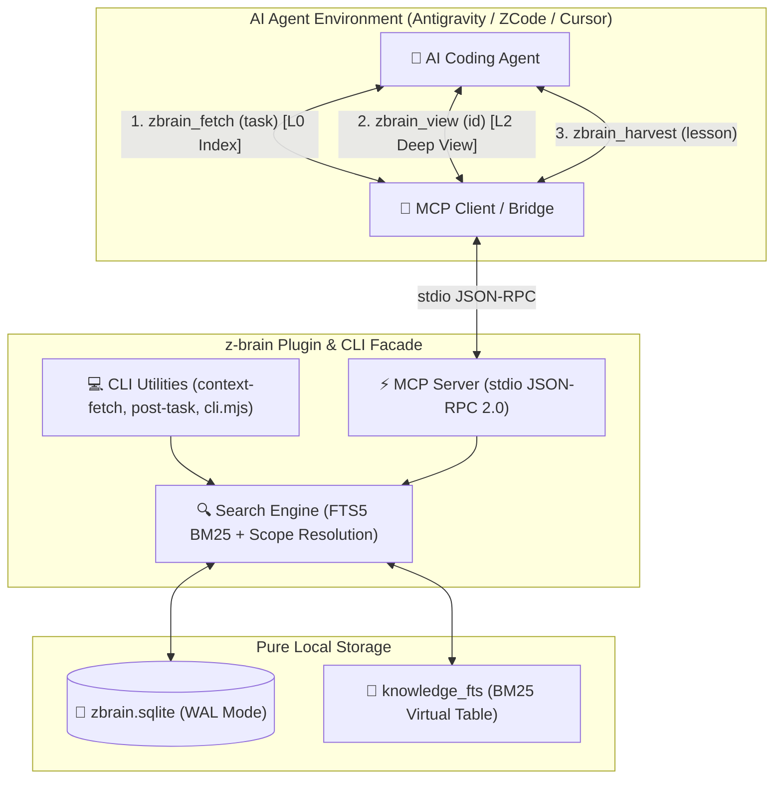

# ⚠️ [ARCHIVED] Repository Moved to [kzxl/z-plugin](https://github.com/kzxl/z-plugin)

> [!IMPORTANT]
> **This repository has been archived and consolidated into the official [`z-plugin`](https://github.com/kzxl/z-plugin) monorepo.**
> 
> All active development, updates, and releases for **`z-brain`** (along with `z-token`) now live at:
> 
> 👉 **[https://github.com/kzxl/z-plugin/tree/main/plugins/z-brain](https://github.com/kzxl/z-plugin/tree/main/plugins/z-brain)**
> 
> This repository is kept in **read-only archive mode** to preserve the complete development history from Phase 0 to Phase 4.

---

# 🧠 z-brain — Zero-Overhead Local Memory Engine & Plugin for AI Agents

[](https://nodejs.org)
[](https://sqlite.org)
[](https://modelcontextprotocol.io)
[](https://github.com/kzxl/z-brain)
[](LICENSE)

**z-brain** (formerly *agentic-brain*) is an ultra-fast, zero-overhead, 100% offline episodic knowledge engine and IDE plugin designed for autonomous AI coding agents ([Antigravity](https://github.com/kzxl), [ZCode](https://github.com/kzxl), Claude, Cursor, Cline, OpenCode).

Engineered from first principles around **Context-Diet** and **Zero-Infrastructure**, it eliminates heavy remote database servers and background memory daemons in favor of an embedded, pure local SQLite engine with FTS5 BM25 indexing and Model Context Protocol (MCP) tools.

---

## ⚡ Why z-brain?

| Dimension | Legacy Architecture | z-brain (Phase 4) |
| :--- | :--- | :--- |
| **Infrastructure** | PostgreSQL + pgvector + AME Daemon | **Zero server**; pure embedded SQLite WAL (`node:sqlite`) |
| **Network & Latency** | Remote TCP/LAN (~20–80 ms) | **Sub-millisecond** (< 2 ms local FTS5 BM25 search) |
| **Context Overhead** | Heavy text dumps (2,000+ tokens/hit) | **L0 Progressive Disclosure** (~30–50 tokens/hit) |
| **Integration** | Ad-hoc scripts & manual REST API | **Antigravity / ZCode Plugin** with native MCP server |
| **Operational Cost** | Server RAM, disk daemon, maintenance | **Zero background RAM**, single portable `.sqlite` file |

---

## 🏛️ Architecture



---

## ✨ Core Principles

### 1. Progressive Disclosure (L0 Index / L2 View)
Rather than blowing the LLM context window with large document dumps:
- **Tier L0 (Compact Index):** `zbrain_fetch` returns ultra-compact 1-line signatures (`[#ID] Problem › Gotcha/Fix`) at only ~30 tokens per item.
- **Tier L2 (On-Demand Deep View):** The agent only invokes `zbrain_view(id)` when it specifically requires full implementation snippets, invariants, and historical revisions.

### 2. Zero-Infrastructure Reliability
- Uses Node.js 22+ built-in synchronous SQLite bindings (`node:sqlite`).
- SQLite configured with `PRAGMA journal_mode = WAL` and `PRAGMA synchronous = NORMAL` for zero read-write lock contention.
- Zero external daemons or services to maintain, restart, or troubleshoot.

### 3. Provenance & Trust Levels
Every knowledge atom is classified by trust and scope:
- **Trust Hierarchy:** `verified_fact` > `user_decision` > `inference` > `observation` > `hypothesis`.
- **Scope Model:** Strict multi-tenant project separation (`project:my-app`) with seamless fallback to curated global engineering invariants (`scope:global`).

---

## 🚀 Quick Start

### 1. One-Click Plugin Installation (Antigravity & ZCode)

Link `z-brain` into your local agent environment with a single command:

```powershell
# From repository root
powershell -ExecutionPolicy Bypass -File install.ps1
```

This establishes zero-copy directory junctions in:
- `~/.gemini/config/plugins/z-brain`
- `~/.zcode/plugins/z-brain`

Restart or reload your IDE to activate all 5 MCP tools immediately.

### 2. Verify Engine Status

```bash
# Check local database metrics
node plugins/z-brain/scripts/cli.mjs status
```

Output:
```text
🧠 Z-Brain Engine Status:
  • Backend: Pure Local SQLite WAL (node:sqlite)
  • Architecture: Zero-Server, Zero-Network, Zero-AME
  • Storage Path: ...\plugins\z-brain\data\zbrain.sqlite
  • File Size: 4.57 MB
  • Total Knowledge Atoms: 3441
  • FTS Engine: FTS5 BM25 Active
  • Concurrency: WAL mode (Zero read-write locks)
```

---

## 🛠️ MCP Tools Reference

When running inside Antigravity or any MCP-compatible client, `z-brain` provides 5 tools:

| Tool | Parameters | Description |
| :--- | :--- | :--- |
| `zbrain_fetch` | `task`, `project?`, `tags?`, `limit?` | High-speed L0 index sweep. Call before coding or refactoring. |
| `zbrain_view` | `id` | Inspect complete root cause, code snippet, and evidence for a specific ID. |
| `zbrain_harvest` | `problem`, `cause`, `fix`, `project?`, `tags?`, `trust?` | Record verified engineering lessons post-task. |
| `zbrain_query` | `query`, `project?`, `minTrust?`, `limit?` | Advanced parameterized search with trust filtering. |
| `zbrain_status` | *(none)* | Inspect engine health, atom counts, and SQLite database size. |

---

## 💻 CLI & Developer Workflows

### Pre-Task Context Lookup
```bash
# SSoT workflow for agent sessions
node tools/context-fetch.js "Fix database deadlock during inventory sync"
```

Example Output:
```text
============================================================
[CONTEXT RESULT] 5 relevant QA entries found
============================================================
📌 [PROGRESSIVE DISCLOSURE: L0 INDEX] (Run: node brain.js view <id>)

[#4362] [rd, tech:sqlite, project:agentic-core] Test SQLite direct harvest
      └─ Gotcha/Fix: Local Z-Brain decoupling | Pure local node:sqlite with zero server dependency
[#4363] [rd, tech:sqlite, project:agentic-core] Test SQLite post-task verification
      └─ Gotcha/Fix: Verified Z-Brain integration | 100% local SQLite storage
```

### Deep View
```bash
node tools/view-qa.js 4362
```

### Post-Task Harvesting
```bash
# Structured single lesson
node tools/post-task.js "Deadlock on RefInId | Missing composite index | Added composite index" --direct --project=erp --tags=inventory,database

# Multi-atom JSON ingestion
node tools/ingest-knowledge.js --file=atoms.json --project=erp
```

---

## 🧪 Test Suite & Quality Verification

```bash
# Run complete test suite (33/33 PASS)
npm test
```

All 33 automated tests verify:
- Phase 0–3: Schema integrity, deterministic project scoping, atomic deduplication, and trust promotion.
- Phase 4: Local SQLite WAL initialization, FTS5 BM25 multi-angle query execution, and project multi-tenancy.

---

## 📈 Evolutionary Roadmap & History

The repository maintains an unbroken development history spanning all evolutionary phases:

- **Phase 0–1 (Foundation):** Multi-tenant scoping, quality guards, atomic JSON ingestion, eliminating raw LLM summary hallucinations.
- **Phase 2–3 (Maturity):** Provenance tracking, trust promotion gates, lifecycle curation (`active` / `stale` / `archived`), and ANN vector baselines.
- **Phase 4 (Current — Local Decoupling):** Complete elimination of remote PostgreSQL, pgvector, and AME IPC dependencies. Unification into **z-brain** as an embedded SQLite FTS5 engine and native Antigravity/ZCode plugin.

---

## 📄 License

Licensed under the [MIT License](LICENSE).
